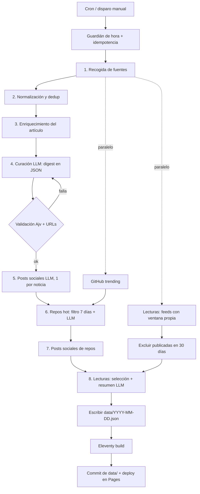

# Flujo técnico de creación de las noticias

Documento técnico del proceso que convierte fuentes RSS, la API de Hacker News, las tendencias de GitHub y los feeds de lecturas en la edición diaria publicada. Describe cada paso, el archivo que lo implementa y las decisiones de diseño relevantes.

## 1. Visión general

El proyecto es un sitio estático: no hay servidor ni base de datos. Un workflow de GitHub Actions ejecuta a mediodía un único orquestador (`pipeline/index.ts`), que produce un JSON por edición en `data/YYYY-MM-DD.json` (fecha civil en `Europe/Madrid`). Eleventy transforma esos JSON en HTML y GitHub Pages lo sirve.

El modelo de lenguaje (DeepSeek por defecto) se usa como un paso más del script, con prompts fijos en `prompts/` y salida validada contra un JSON Schema. Nunca se le deja inventar datos duros como las URL.



## 2. Disparo y planificación

Fichero: `.github/workflows/daily.yml`.

- **Crons.** GitHub solo entiende UTC y puede retrasar u omitir ejecuciones cuando tiene carga. El workflow programa cinco intentos horarios, de `10:15` a `14:15` UTC (12:15–16:15 en verano, 11:15–15:15 en invierno), ya en tarifa valle de DeepSeek (fuera de 01:00–04:00 y 06:00–10:00 UTC). El guardián y la idempotencia hacen que solo el primero válido publique.
- **Guardián de hora.** El paso `guard` usa la hora UTC y solo deja continuar el `schedule` (`run=true`) si son las 10:00 o más, para no generar en pico aunque GitHub dispare pronto. Un disparo manual (`workflow_dispatch`) se ejecuta sin comprobar la hora. A esa hora, la fecha civil en `Europe/Madrid` es siempre el día que toca.
- **Idempotencia.** El orquestador aborta pronto si ya existe `data/<hoy>.json` escrito entero (fecha en Madrid; ver la sección de curación). El commit de la edición solo se crea si hay cambios en `data/`, así que dos crons el mismo día no publican dos veces.
- **Entrada manual `skip_pipeline`.** Reconstruye y despliega el sitio sin regenerar la edición (salta el paso del pipeline y va directo al build).
- **Permisos y concurrencia.** El job pide `contents: write`, `pages: write`, `id-token: write` e `issues: write`, y usa un grupo de `concurrency` para no solaparse consigo mismo. Si algún paso falla, un paso final abre un issue con enlace al run.

## 3. Configuración

Ficheros: `config/sources.json` y `pipeline/config.ts`.

`loadConfig()` lee el JSON y lo valida con Ajv antes de devolverlo (`validateSourcesConfig`): un campo obligatorio ausente o de tipo equivocado falla al arrancar nombrando el campo. El mini-esquema de `config.ts` exige los campos que el pipeline consume de verdad; `SourcesConfig` de `pipeline/types.ts` documenta la forma resultante. Campos globales relevantes:

| Campo | Uso |
|---|---|
| `window_hours` | Ventana temporal de recogida (24 h por defecto). |
| `candidate_cap` | Máximo de candidatos que pasan a curación tras normalizar. |
| `enrich_top` | Cuántos candidatos con más señal se enriquecen leyendo el artículo. |
| `timeout_ms`, `enrich_timeout_ms` | Timeouts de red. |
| `user_agent` | User-Agent identificable en todas las peticiones. |

Cada fuente RSS tiene `enabled` y `fragile`. Una fuente frágil que falla se registra con un aviso más suave y se omite, sin bloquear por sí sola la edición. Los bloques `hackernews`, `huggingface_trending` (desactivado), `github_trending` y `lecturas` configuran las fuentes que no son RSS. La sección `lecturas` es opcional y define su propia ventana, cap, número de lecturas, días de exclusión y feeds (ver la sección de Lecturas).

## 4. Paso 1: Recogida

Ficheros: `pipeline/sources/index.ts` (orquestador), `pipeline/sources/rss.ts`, `pipeline/sources/hackernews.ts`, `pipeline/sources/huggingface.ts`, `pipeline/http.ts`.

`collectAll()` construye la lista de tareas a partir de las fuentes habilitadas y las ejecuta en paralelo con `Promise.allSettled`. Tolerancia a fallos:

- Una fuente que falla se registra y se omite.
- Solo se considera fatal si fallan **todas** (el orquestador aborta antes de curar).
- Las fuentes marcadas `fragile` (por ejemplo el mirror no oficial de Anthropic) se registran con un aviso más suave.

Cada fuente devuelve `NewsItem[]` normalizados al formato común `{ title, snippet, url, source, published_at, points?, content? }`. El XML se descarga con `fetchText` (User-Agent y timeout propios) y solo se parsea con `rss-parser`. Hacker News usa su API pública filtrando por `min_points` y por una lista de queries.

La recogida de tendencias de GitHub es una llamada aparte, no forma parte de `collectAll`, porque su salida no son noticias sino repositorios (ver paso 6).

## 5. Paso 2: Normalización

Fichero: `pipeline/normalize.ts`.

- **`canonicalUrl()`** canonicaliza cada URL para deduplicar: quita el fragmento `#...`, los parámetros de tracking (`utm_*`, `ref`, `fbclid`) y la barra final.
- **Blocklist de dominios.** `blocked_domains` en `config/sources.json` descarta agregadores y rehosts (el host exacto y cualquier subdominio) antes de deduplicar. Los ítems de Hacker News registran el dominio de destino para alimentar esa lista.
- **Deduplicación.** Se agrupa por URL canónica en un `Map`. En una colisión se conserva el primer ítem, pero hereda la mayor puntuación disponible y el `snippet` si le faltaba.
- **Orden por señal.** Primero por puntos de Hacker News (descendente), y a igualdad, por fecha de publicación más reciente.
- **Cap.** Se recorta a `candidate_cap` para acotar el tamaño del prompt de curación.

## 6. Paso 3: Enriquecimiento

Fichero: `pipeline/enrich.ts`.

Para los primeros `enrich_top` candidatos (ya ordenados por señal), se descarga la página real y se extrae texto legible, de modo que el resumen no dependa solo del titular.

- **`extractReadable()`** toma la meta descripción (`og:description` o `description`) más los primeros párrafos largos (mínimo 60 caracteres), hasta un tope de 1200 caracteres.
- **Concurrencia.** Un pool de 6 workers procesa los objetivos en paralelo.
- **Tolerante a fallos y paywalls.** Si la respuesta no es HTML, da error o el texto extraído es demasiado corto, ese ítem se queda sin `content` y se seguirá usando su `snippet`. Si no se lee ningún artículo, se registra un aviso pero el pipeline continúa.

## 7. Paso 4: Curación

Ficheros: `pipeline/curate/index.ts`, `prompts/curacion.md`, `pipeline/validate.ts`, `schema/digest.schema.json`.

Antes de llamar al modelo, el orquestador (`pipeline/index.ts`) comprueba dos condiciones de salida temprana:

1. **Idempotencia.** Si existe `data/<hoy>.json` escrito entero (parsea, con fecha e ítems con url y título), no hace nada; uno truncado se regenera. La escritura es atómica (temporal y `rename`).
2. **Sin credencial.** Si el proveedor no tiene su API key, no es un error: se conserva la última edición y el sitio se reconstruye igualmente.

Si hay menos de 8 ítems normalizados (`MIN_ITEMS`), se aborta sin publicar.

`curate()` hace lo siguiente:

- Lee el prompt de sistema `prompts/curacion.md` (rol de editor jefe, criterio de priorización con la IA como eje dominante y lo práctico por delante de lo financiero).
- Construye el prompt de usuario con los ítems y las cabeceras (`buildUserPrompt`). Las URL se listan literalmente para que el modelo las copie sin modificarlas. El contenido de las fuentes va entre los delimitadores `===== INICIO CONTENIDO NO CONFIABLE =====` y `===== FIN CONTENIDO NO CONFIABLE =====` para que el modelo lo trate como material a resumir y no como instrucciones. Antes de recortarlos, títulos y cuerpos colapsan todo espacio en blanco, saltos de línea incluidos, a un solo espacio: los títulos se recortan a 200 caracteres y los cuerpos a 600, de modo que un título no puede cerrar el bloque delimitado.
- Llama al proveedor pidiendo salida en JSON.
- Fuerza `date`, `generated_at` y `provider` desde el propio script (`coerceMeta`), no desde el modelo.
- **Valida** con `validateDigest()`: primero contra el JSON Schema (Ajv), y después dos comprobaciones fuera del schema: cada `url` del digest debe existir en las URL de entrada (el modelo elige, nunca inventa) y los `rank` deben ser únicos y contiguos desde 1, sin huecos. Antes de validar, `dropInventedUrlItems()` descarta los ítems con URL fuera de la entrada y renumera los `rank` de los que quedan; si tras el descarte no llegan a `MIN_ITEMS`, la validación falla y se reintenta.
- **Reintentos.** Hasta 3 intentos (1 más 2 reintentos). Un error reintentable de `generate()` (red, timeout, o un `ProviderError` marcado como reintentable) consume intento y espera un backoff creciente de 2 s y 4 s antes del siguiente, con el prompt base. Un error permanente (por ejemplo 401 o 400) no se reintenta y pasa directo al proveedor alternativo. Si un intento no valida (JSON o schema), se inyecta el error concreto en el prompt y se reintenta. Si el proveedor principal agota los intentos y el alternativo tiene credencial, se hace failover automático y el digest lleva el `provider` del que curó. Si tras toda la cadena sigue sin validar, lanza y el pipeline aborta (exit distinto de 0).

## 8. Paso 5: Posts sociales

Ficheros: `pipeline/curate/social.ts`, `prompts/social.md`, `prompts/repos-social.md`.

Tras una curación válida, `attachSocial()` genera el texto para X y LinkedIn de cada noticia. Después de seleccionar los repositorios, `attachRepoSocial()` hace lo mismo para cada repo con un prompt de tono más práctico y viral. Ambos procesos son **best effort**: si una llamada falla, la edición se publica sin ese post.

- **Una llamada por noticia o repositorio**, en paralelo acotado (lotes de 5, `mapPool`). El fallo es granular: si un elemento falla, los demás igual obtienen sus posts.
- El modelo devuelve, por noticia, `hook_x`, `hook_linkedin` y `hashtags`. El gancho va como primera línea (lo que frena el scroll).
- **Ensamblado para X** (`assembleX`): texto plano (las letras Unicode en negrita cuentan doble en X). El gancho es el post; si no cabe en 280 contando la URL como 23, primero se sueltan los hashtags y luego se recorta el gancho.
- **Ensamblado para LinkedIn** (`assembleLinkedIn`): tope de 3000 caracteres, el máximo del schema. X recorta a 280 contando la URL como 23 y el schema admite 600 caracteres reales; si una URL muy larga lo supera, se omite el bloque `social` igual que con LinkedIn. El gancho abre y la idea clave marcada por el modelo con `**...**` se convierte a negrita Unicode (`applyBold`, `boldSans`), porque LinkedIn no renderiza markdown. Si el post resultante supera los 3000, se omite el bloque `social` de esa noticia o repo y se registra un aviso, para no publicar un JSON inválido.
- El texto se guarda en `item.social` / `repo.social`. La web lo abre con web intents; no se publica por API.

## 9. Paso 6: Repositorios hot

Ficheros: `pipeline/sources/github.ts`, `prompts/repos.md`, `pipeline/curate/repos.ts`, `pipeline/index.ts`.

Sección independiente de las noticias, también **best effort**.

- **Recogida** (`collectGithubTrending`): intenta el scraping de `github.com/trending` (`parseTrending` extrae owner/repo, descripción, lenguaje y estrellas de cada `article.Box-row`). Si el HTML responde 200 y no se parsea ningún repo, el parser está roto: se registra un aviso y el workflow diario abre un issue (`fallo-automatico`) aunque la Search API complete la sección. Con un parseo parcial (menos de `min_parse_alert` repos, 5 por defecto) se **combinan** las dos vías: primero los del scraping y después los de la Search API que no estén ya (dedupe por `name`), hasta `gh.limit`; el issue solo se abre si la combinación no llega al umbral (se mide antes de excluir los repos publicados en los 7 días previos: la alerta vigila el parser, no el tamaño final de la sección). Si el scraping falla (red o HTTP no 2xx) no hay alerta de parseo y se usa la Search API oficial (`created:>hace 7 días`, ordenado por estrellas), con el `GITHUB_TOKEN` que el workflow diario pasa al pipeline. Si ambas vías fallan, devuelve lista vacía y la sección no aparece. Hay un fixture de regresión con HTML real en `pipeline/__tests__/fixtures/github-trending.snapshot.html`.
- **Ventana sin repeticiones**: antes de la curación, `loadRecentRepoNames()` lee los repos publicados en las siete ediciones naturales anteriores y `excludeRecentRepos()` los elimina de los candidatos. Un repositorio puede volver a aparecer a partir del octavo día.
- **Selección y descripción** (`attachRepos`): una tercera llamada al modelo (prompt `prompts/repos.md`) que elige los repos más interesantes para el diario (IA y herramientas prácticas primero) y los describe en castellano. Los datos duros (nombre, URL, lenguaje, estrellas) se toman **siempre** del repo recogido, no de la respuesta del modelo; del modelo solo se usa la descripción. El resultado se guarda en `digest.repos`.

## 10. Sección Lecturas

Ficheros: `pipeline/sources/lecturas.ts`, `pipeline/curate/lecturas.ts`, `prompts/lecturas.md`, `pipeline/index.ts`.

Sección independiente de las noticias y también **best effort**: aporta seis lecturas atemporales (tutoriales, ensayos, guías de ingeniería, IA, web, datos, diseño) de Medium y blogs técnicos, elegidas y resumidas por el modelo. No compite con las noticias en la curación principal.

- **Recogida** (`collectLecturas`): reutiliza `collectRss` con la ventana propia de `lecturas.window_hours` (168 h), en paralelo y con `Promise.allSettled`. Un feed que falla se registra y se omite; si fallan todos, la lista queda vacía. Normaliza con las mismas reglas que las noticias (`candidate_cap` y `blocked_domains`). En las URL de Medium y de sus dominios propios (`towardsdatascience.com`, `netflixtechblog.com`) se quita el parámetro `source` que añade su RSS.
- **Sin repeticiones** (`loadRecentLecturaUrls`, `excludeRecentLecturas`): se descartan las URL ya publicadas en `lecturas` en las ediciones de los `lookback_days` días previos (30 por defecto), igual que los repos en su ventana de siete días.
- **Curación** (`attachLecturas`): una llamada al modelo después de la curación principal, con el contenido de entrada delimitado por `untrustedBlock` como material no confiable. El modelo devuelve `{ lecturas: [{ url, title, summary, tema }] }`; la URL debe estar en la entrada (si no, se descarta) y `source` sale siempre del candidato. `title` se recorta a 200 y `summary` a 600 caracteres (dos o tres frases sobre qué aprende quien lo lee), y `tema` debe pertenecer a `programacion | ia | web | datos | arquitectura | diseno | carrera`. Lo inválido se descarta con un aviso y, si falla todo, la edición se publica sin la sección.
- El resultado se guarda en `digest.lecturas` y lo valida `schema/digest.schema.json`. La web todavía no lo renderiza; ese cambio va aparte.

## 11. Paso 7: Render y publicación

Ficheros: `pipeline/index.ts`, `eleventy.config.mjs`, `site/_data/editions.js`, `site/_includes/`, `site/*.njk`.

- El orquestador escribe `data/YYYY-MM-DD.json` de forma atómica (`writeFileAtomic`: temporal y `rename`).
- **Eleventy** (`pnpm run build`) lee todas las ediciones vía `site/_data/editions.js`, que ordena los ítems de cada edición por `rank`, ordena las ediciones de más reciente a más antigua y calcula número, rutas y vecinos.
- Las plantillas Nunjucks renderizan el sitio. `site/_includes/edicion.njk` compone la edición de noticias (el destacado `items[0]` más la rejilla de noticias) y `archivo.njk` el histórico de ediciones. `eleventy.config.mjs` aporta los filtros de fecha en español, el separador de miles y `shareModel` (web intents).
- **Web intents.** Donde ya se muestran los posts (`share.njk` en noticias y repos), X abre `https://x.com/intent/post?text=...` y LinkedIn el compositor del feed (`shareActive` + `text`). LinkedIn no documenta un intent con cuerpo arbitrario (su `share-offsite` solo admite URL); el botón de copiar deja pegar el texto si el feed no lo precarga. Sin texto social no se pintan botones.
- **Navegación unificada.** Cada sección lleva arriba un botón que despliega un **calendario** en un popover (`site/_includes/calendario.njk` + `site/js/calendario.js`; `<details>` que se cierra al clic fuera o con Escape): abre en el día actual, resalta ese día y solo deja seleccionar los días con edición (el resto quedan deshabilitados); las fechas disponibles se inyectan como JSON y el JS renderiza el mes y navega entre meses dentro del rango publicado. Debajo, una barra secuencial (`nav-temporal.njk`) lleva al día anterior o siguiente. La cabecera (`base.njk`) resalta la pestaña activa entre Noticias, Repositorios y Archivo.
- **Sección de repositorios.** Los repos se muestran en su propia pestaña, no dentro de la edición. `site/_data/reposEditions.js` expone las ediciones que tienen repos (con ruta bajo `/repositorios/` y sus vecinos), y las plantillas `repositorios.njk` (portada) y `repos-dia.njk` (una página por fecha) renderizan la lista reutilizando el include `repos-lista.njk`.
- **Archivo unificado.** `/archivo/` es un índice (`archivo.njk`) que enlaza a `/archivo/noticias/` (`archivo-noticias.njk`), `/archivo/repositorios/` (`archivo-repositorios.njk`) y `/archivo/buscar/` (búsqueda en el navegador sobre un índice de título, resumen y fuente generado en el build).
- **Resumen semanal.** `/semana/` se construye desde los JSON de los últimos 7 días (destacada de cada día, temas por categoría, repos), sin llamada al modelo.
- **Distribución.** Eleventy genera `/feed.xml` (RSS 2.0), `/atom.xml`, `/sitemap.xml` y `/robots.txt`. La plantilla base incluye canonical, Open Graph y `rel=alternate` a los feeds.
- **Publicación.** El workflow hace `git add data/`, crea el commit de la edición solo si hay cambios, reintegra los cambios remotos con `git pull --rebase` para no perder la edición ante un push concurrente, y despliega `_site` en GitHub Pages.

## 12. Proveedores de modelo

Ficheros: `pipeline/ports.ts`, `pipeline/providers.ts`, `pipeline/curate/deepseek.ts`, `pipeline/curate/claude-code.ts`.

- **DeepSeek** (por defecto): endpoint compatible con el formato de OpenAI, JSON mode, `temperature` 0.3 y timeout amplio (Flash razona por defecto y puede tardar). Modelo configurable con `DEEPSEEK_MODEL`; por defecto, `deepseek-v4-flash`.
- **claude-code** (alternativo): invoca el CLI de Claude Code en modo headless vía suscripción. No probado end to end.
- La interfaz común (puerto) es `Provider.generate(systemPrompt, userPrompt): Promise<string>`, definida en `pipeline/ports.ts`. `pipeline/providers.ts` es la raíz de composición: `resolveProviderName()` elige según `LLM_PROVIDER`, `providerCredentialPresent()` permite saltar sin fallar si no hay credencial y `resolveProviderChain()` construye la cadena con failover que `pipeline/index.ts` pasa a `curate()`. El caso de uso no importa adaptadores; `pipeline/__tests__/architecture.test.ts` lo vigila con `.hexagonal.json`.

## 13. Esquema de datos y tipos

Ficheros: `schema/digest.schema.json`, `pipeline/types.ts`.

El digest tiene `date`, `generated_at`, `provider`, un array `items` (de 8 a 20 noticias, con `rank`, `category`, `title`, `summary`, `why_it_matters`, `url`, `source` y `social` opcional), un array opcional `repos` y un array opcional `lecturas` (máximo 10, con `title`, `url`, `source`, `summary` y `tema`). Los campos `social`, `repos` y `lecturas` se rellenan **después** de la validación del schema, igual que se documenta para las noticias.

## 14. Tolerancia a fallos

| Situación | Comportamiento |
|---|---|
| Una fuente falla | Se omite; la recogida continúa. |
| Fallan todas las fuentes | Aborta con exit 1. |
| Menos de 8 ítems normalizados (`MIN_ITEMS`) | Aborta sin publicar. |
| No se enriquece ningún artículo | Aviso; se usan los snippets. |
| Curación no valida o cae la red | Reintenta (3, con backoff de 2 s y 4 s si el error es reintentable) y, si hay credencial, prueba el otro proveedor. Si ambos fallan, aborta con exit 1. |
| GitHub Trending parsea < umbral con HTTP 200 | Aviso; se combinan los repos del scraping y los de la Search API (dedupe por `name`) hasta `limit`. Con 0 repos parseados el issue automático se abre siempre; con parseo parcial, solo si la combinación no llega al umbral. |
| Posts sociales fallan | La edición se publica sin posts. |
| Repos hot fallan (scraping y API) | La edición se publica sin la sección. |
| Lecturas fallan (todos los feeds o el modelo) | La edición se publica sin la sección. |
| Sin credencial del proveedor | No se genera edición nueva; se conserva la última. |
| Ya existe la edición de hoy escrita entera | No se hace nada (idempotencia). Si está truncada, se regenera. |

## 15. Ejecución local

```bash
corepack enable
pnpm install --frozen-lockfile
pnpm run pipeline -- --collect-only   # imprime los ítems normalizados, sin llamar al modelo
pnpm test                             # normalización, validación, trending, deduplicación de repos, lecturas y posts
pnpm run typecheck                    # tsc --noEmit
pnpm run build                        # genera _site/
pnpm run dev                          # servidor local

# Edición real (requiere credencial):
export DEEPSEEK_API_KEY=sk-...       # PowerShell: $env:DEEPSEEK_API_KEY="sk-..."
pnpm run pipeline                     # escribe data/<hoy>.json
```
